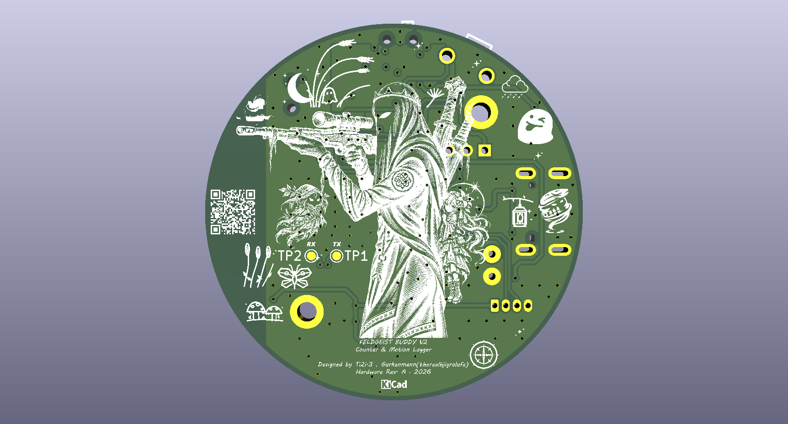
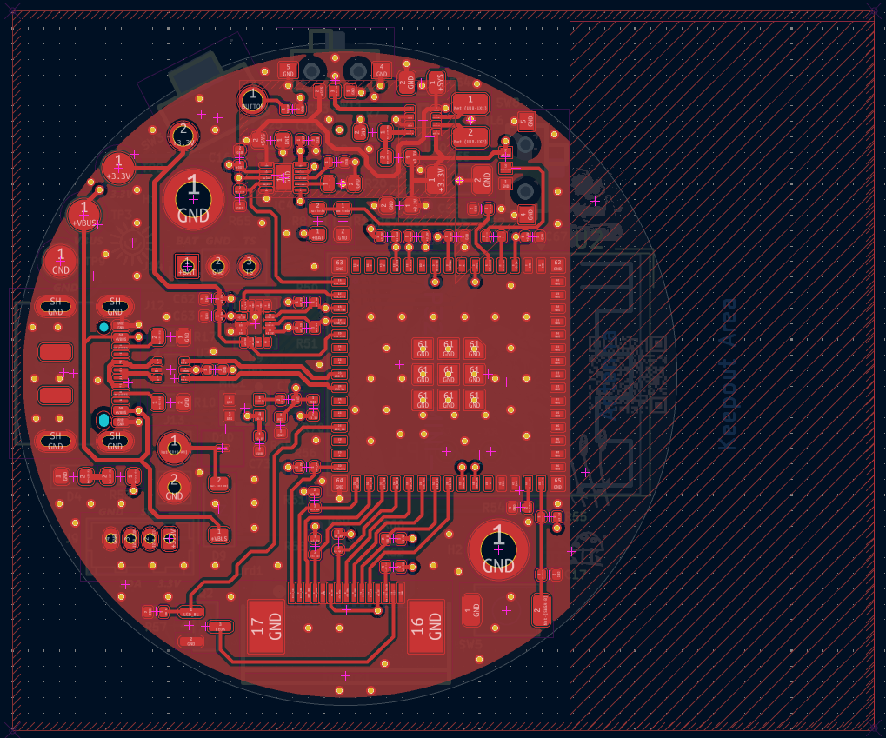
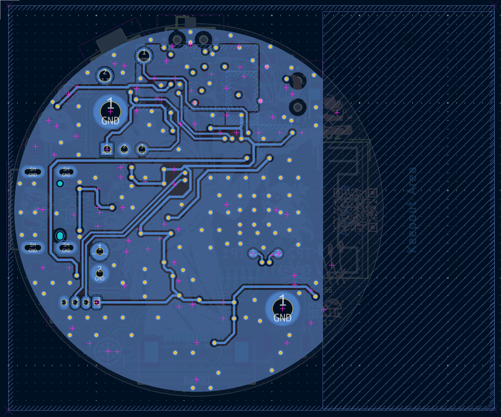
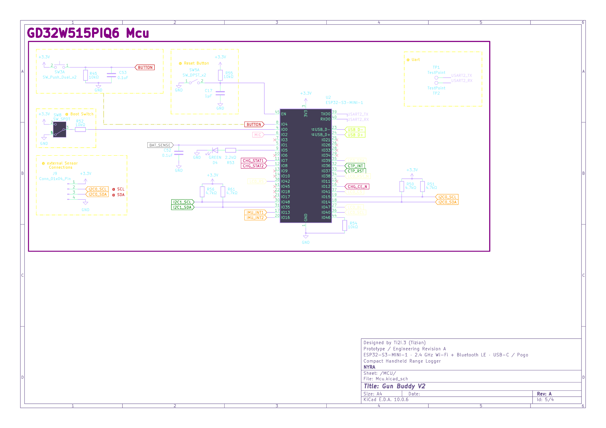
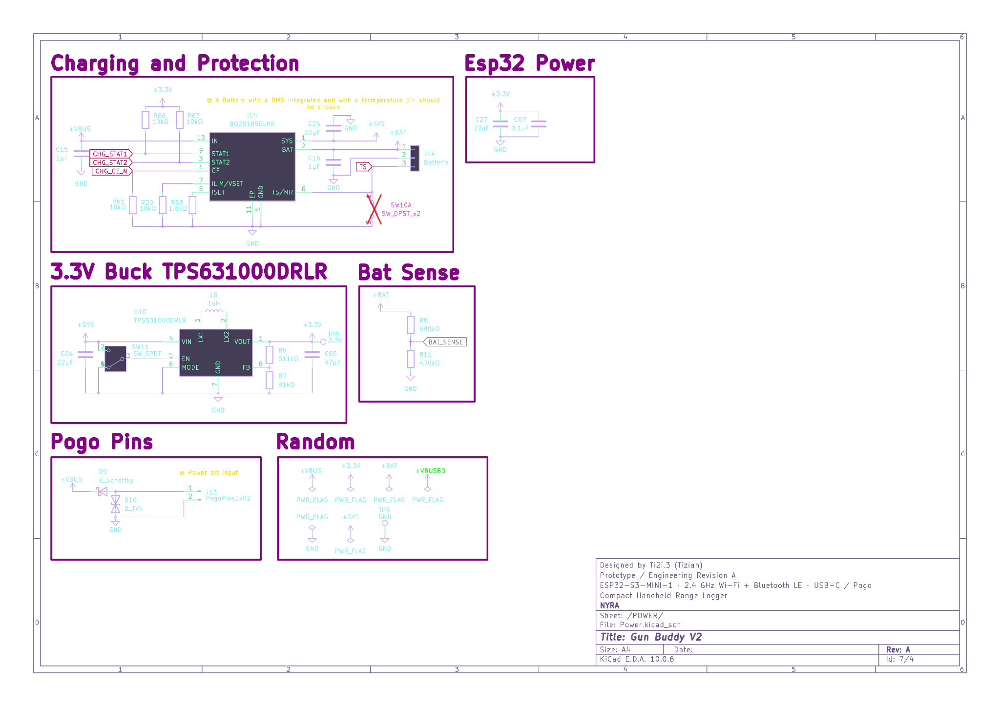

# Feldgeist Buddy V2

A small ESP32-S3-based handheld designed to be carried as a keychain. It has a round touchscreen, a six-axis IMU and a rechargeable battery. Planned applications include step counting, motion logging and simple games.

**Status:** Hardware Rev. A designed, not yet manufactured or tested.

| Front | Back |
| :---: | :---: |
|  |  |

*KiCad 3D renders. Some component models are missing.*

## Hardware

| Component | Specification |
| --- | --- |
| MCU | ESP32-S3-MINI-1-N4R2 |
| Memory | 4 MB flash, 2 MB PSRAM |
| IMU | LSM6DSV32XTR |
| Display | 1.28-inch IPS LCD, 240 × 240, GC9A01A |
| Touch controller | CST816D |
| Microphone | ZTS6117 |
| Battery | Single-cell LiPo, capacity TBD |
| Battery charger | BQ25185 |
| Voltage regulator | TPS631000, 3.3 V buck-boost |
| Connectivity | USB-C, Wi-Fi, BLE |
| PCB | Ø42.5 mm, 4 layers |

## PCB layout

| Front | Back |
| :---: | :---: |
|  |  |

Additional PCB views

| Front | Back |
| :---: | :---: |
|  |  |

## Schematics

Main schematic

MCU

Peripherals

Power supply

KiCad project files: [`Kicad/`](Kicad/).

## Development status

- [x] Rev. A schematic and PCB layout
- [ ] PCB fabrication and assembly
- [ ] Hardware testing
- [ ] Firmware
- [ ] 3D-printed enclosure

## Credits and license

PCB design: Ti2i1. Design feedback from the electronics community on Discord. AI-assisted research, troubleshooting and silkscreen artwork.

No project license has been selected. Third-party materials retain their respective licenses.
