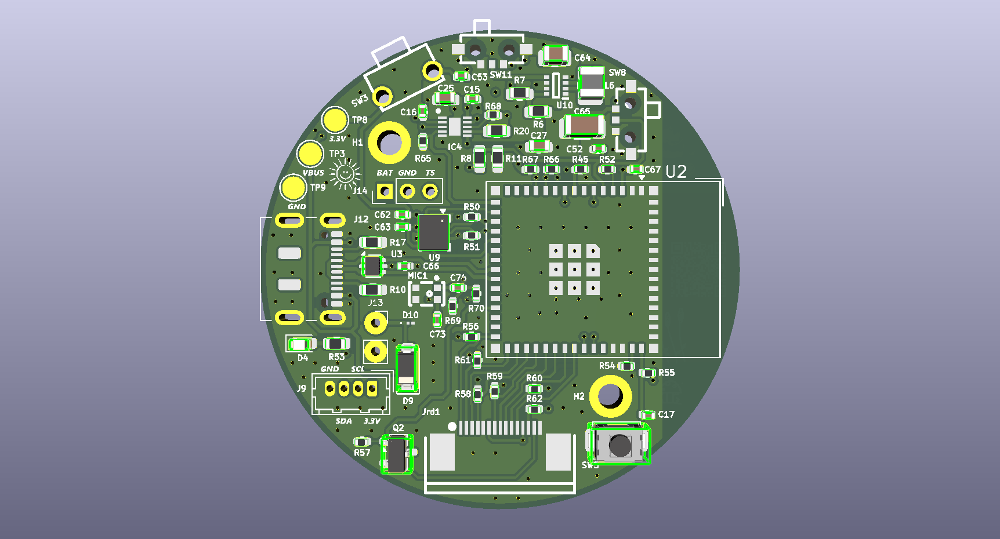
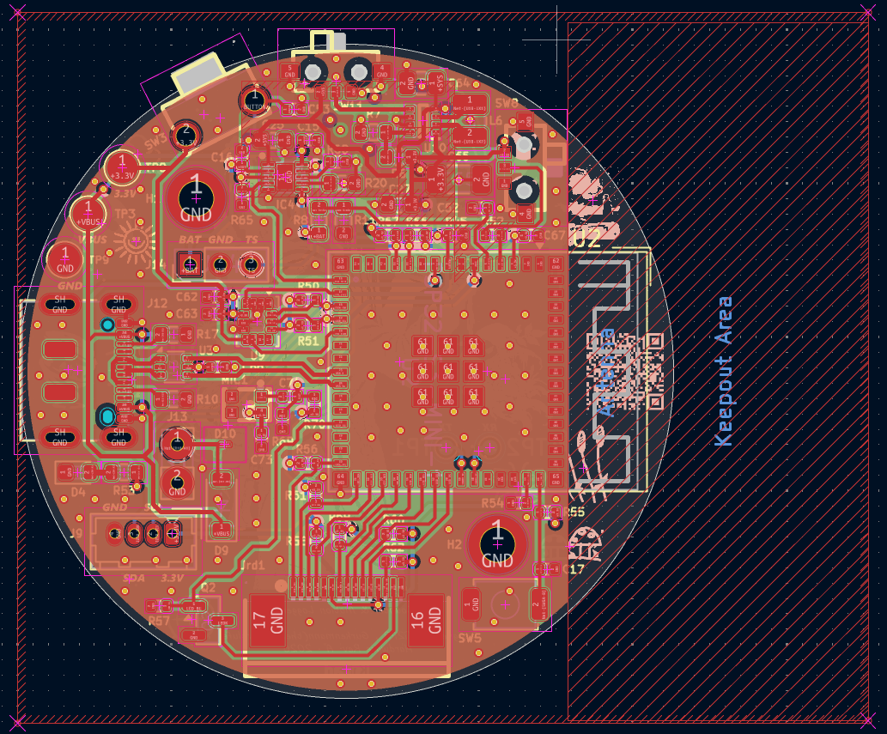
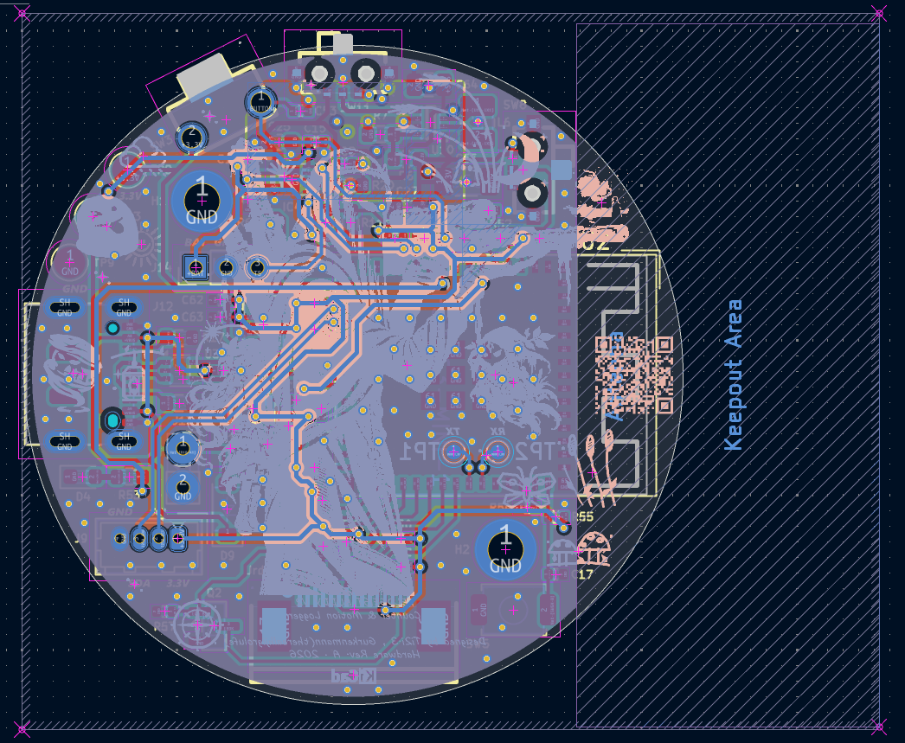
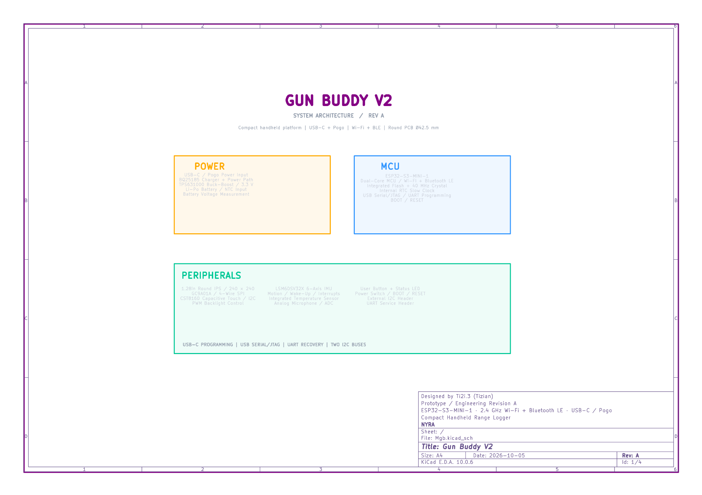
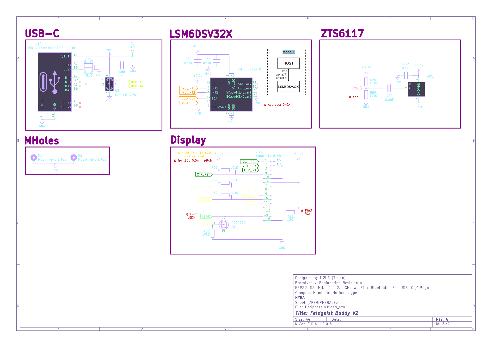

<h1 align="center">FELDGEIST · BUDDY V2</h1>

<p align="center">
  <strong>A little spirit. A lot of electronics.</strong><br>
  A pocket-sized, programmable electronic companion built around custom hardware.
</p>

<p align="center">
  
  
  
  
</p>

<table>
  <tr>
    <td width="50%" align="center"><br><sub>Front · Component side</sub></td>
    <td width="50%" align="center"><br><sub>Back · Feldgeist artwork</sub></td>
  </tr>
</table>

<p align="center"><sub>Revision A — KiCad renders, not photographs of an assembled prototype. Some component models are not shown.</sub></p>

## About the project

**Feldgeist Buddy V2** (MGB — Mini Ghost Buddy) is a personal embedded hardware project that combines motion sensing, a round display and interactive digital experiences in a compact handheld format. The goal is to create a programmable electronic companion that can be carried as a keychain and used for everyday experiments with sensors, user interfaces and embedded software.

The project is inspired by folklore, particularly mysterious spirits, swamps and nature. The illustrated PCB is part of that identity: I wanted to design something with its own personality rather than just another development board.

I am a high school student from Germany who enjoys designing PCBs, researching components and learning how electronic systems work. One of my previous projects was a simple **27 × 27 mm microcontroller breakout board** that I still use as a keychain today. Feldgeist is a much more ambitious step toward designing a complete electronic device.

## What could Feldgeist do?

These are **planned or exploratory features**, not currently working firmware:

| Feature | Concept |
| --- | --- |
| Digital companion | Animated characters and interactive responses |
| Activity tracker | Step counting and everyday activity tracking |
| Motion lab | Visualize acceleration and orientation for experiments |
| Gesture interaction | Explore movement-based input |
| Mini-games | Small, motion-controlled games |
| Wireless connectivity | Experiment with Wi-Fi and Bluetooth LE |
| Custom applications | A platform for learning embedded development |

## Hardware overview

The hardware is designed around a circular four-layer PCB with a diameter of **42.5 mm**. A rechargeable battery and a compact enclosure are intended to make the device portable.

The following specifications describe the current design, **not measured prototype performance**.

| Subsystem | Current design |
| --- | --- |
| Microcontroller | Espressif ESP32-S3-MINI-1 |
| Wireless | 2.4 GHz Wi-Fi and Bluetooth LE |
| Motion sensor | STMicroelectronics LSM6DSV32XTR, six-axis IMU |
| Display | Planned 1.28-inch round IPS LCD, 240 × 240 pixels |
| Touch | Planned capacitive touch interface |
| Power | Rechargeable single-cell LiPo battery |
| Charging | Onboard charging and power-path management |
| Regulation | 3.3 V buck-boost power supply |
| Connectivity | USB-C, external I²C header, UART service interface |
| User interface | Buttons, status LED and display |
| PCB | Circular, Ø42.5 mm, four copper layers |
| Design software | KiCad |
| Hardware revision | Rev. A |

## PCB design

The layout is the result of several iterations of component selection, placement, routing and design review. The goal is to fit a complete embedded system onto a small circular board without relying on separate development modules for every subsystem.

<table>
  <tr>
    <td width="50%" align="center"><br><sub>Front copper · F.Cu</sub></td>
    <td width="50%" align="center"><br><sub>Back copper · B.Cu</sub></td>
  </tr>
</table>

<details>
<summary>Additional PCB editor views</summary>

| Front overview | Back overview |
| --- | --- |
|  |  |

</details>

The schematic is divided into separate MCU, power and peripheral sheets. The source files are maintained in the [`Kicad/`](Kicad/) directory.

<details>
<summary>Schematic overview — Rev. A</summary>

The following schematics document engineering revision A of Feldgeist Buddy V2 (MGB — Mini Ghost Buddy). The current prototype is intended as a compact, programmable electronic companion for motion sensing, activity tracking, interactive applications, and embedded hardware experimentation.

| System overview | Microcontroller |
| --- | --- |
|  |  |

| Peripherals | Power |
| --- | --- |
|  |  |

</details>

## Current development status

> [!IMPORTANT]
> Feldgeist Buddy V2 is still an engineering prototype. The hardware design has not yet been manufactured or validated. Firmware features, battery life and overall functionality remain to be tested.

| Milestone | Status |
| --- | --- |
| Component research and selection | Advanced |
| Schematic design | Rev. A designed |
| Four-layer PCB layout | Rev. A designed |
| PCB artwork | Designed |
| Physical PCB manufacturing and assembly | Pending |
| Initial hardware validation | Pending |
| Firmware development | Planned |
| 3D-printed enclosure | Planned |
| Complete handheld testing | Pending |

The next milestone is to manufacture a first prototype and establish whether the hardware works as intended. After that, I plan to develop the companion applications and enclosure, learn from the first revision and document the results.

## Repository structure

```text
Feldgeist-Buddy-V2/
├── Kicad/             # Hardware project and design files
├── docs/
│   └── images/        # PCB renders and design screenshots
├── .gitignore
└── README.md
```

Firmware and mechanical design files will be added as development progresses.

## Development and acknowledgements

This is an independently developed learning project. I make the hardware design decisions and work on component selection, schematics and PCB layout myself. Feedback from electronics communities on Discord has helped me identify potential issues and improve my understanding of hardware design.

I also use AI tools to assist with technical research, troubleshooting and creative work, including parts of the silkscreen artwork.

Thank you to everyone who has offered feedback, caught mistakes and encouraged me to keep working on the project.

## License

No project license has been selected yet. Public access to this repository does not automatically grant permission to reuse or redistribute its contents. Third-party materials remain subject to their respective terms.

---

<p align="center"><strong>Feldgeist Buddy V2 · Hardware Rev. A · 2026</strong><br><sub>From an idea to a device I can finally hold in my hands.</sub></p>
